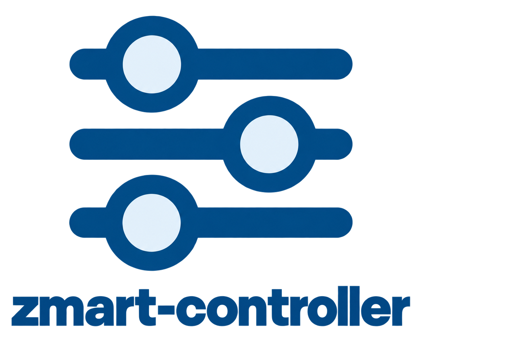
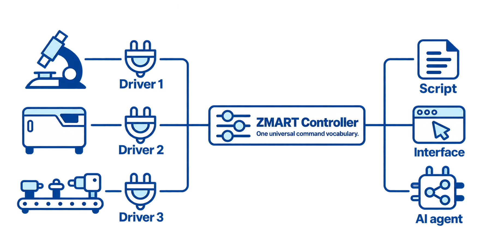

# ZMART Controller

[](https://www.python.org/downloads/)
[](LICENSE)
[](pyproject.toml)
[](https://github.com/ZMB-UZH/ZMART-controller/actions/workflows/tests.yml)
[](#status)

<br>

<table>
<tr>
<td width="170"></td>
<td valign="middle">

The **ZMART Controller** provides a simple, universal schema for driving a microscope using Python. This simplifies testing and simulating workflows and allows you to reuse your workflows on different microscopes.

It is part of [**ZMART**](https://github.com/thomdehoog/ZMART-microscopy) (ZMB's Microscopy-Agnostic Research Toolkit), the tools we are building for smart microscopy at the Center for Microscopy and Image Analysis (ZMB), University of Zurich.

</td>
</tr>
</table>

<br>

## The Problem

When you want to implement an automated workflow on a microscope, you likely run into two problems:

1. **Available time on the microscope is often scarce.** 

2. **You want to share the workflow, but it only runs on your specific microscope.**

<br>

## The Solution

The ZMART controller sits between your workflow and the microscope and addresses these two problems:

1. **A universal interface.** Your workflow talks to the controller instead of to the microscope directly.
   Behind the controller you can plug in a simulated microscope, so you can build and test the whole
   workflow at your desk, then only go to the microscope once it works and when you have time for it.

2. **A common vocabulary.** Your workflow is written in a universal language that is interpreted by a
   ZMART driver, so every microscope that has a ZMART driver can run your workflow.

<p align="center">
  
</p>

### A common vocabulary

Everything you can say to a microscope:

```python
from zmart_controller import mic

# 1) See which drivers are installed and how each connects, then connect to one
mic.get_instruments()
mic.connect(String)

# 2) Learn about the connected setup in more detail
mic.get_info()

# 3) Discover where you are in the xyz space of the canvas, and change the position
#    using the actuators that are available
mic.get_actuators()
mic.get_xyz()
mic.set_xyz(x, y, z, with_actuators=Dict)

# 4) Capture the instrument state, and apply it again later with optional changes
mic.get_state()
mic.set_state(Dict)

# 5) Capture and save an image with the appropriate acquisition settings
mic.get_acquisition_settings()
mic.acquire(position_label=String, acquisition_settings=Dict)

# 6) Run a routine the microscope offers (for example autofocus)
mic.get_procedures()
mic.run_procedure(Dict)

# 7) Close the connection
mic.disconnect()
```

## Want to give it a try?

1. **[Using the ZMART-controller](docs/use_the_controller/README.md).** Every command, what it does, and what it answers.
2. **[How do I plug in a ZMART-driver](docs/plug_in_a_driver/README.md).** What a driver is, how to install it, and how to write one.

## Install it

Install the controller into your Python environment (Python 3.11 or newer; it needs nothing else):

```bash
pip install "git+https://github.com/ZMB-UZH/ZMART-controller"
```

To use it in a project of your own, add it to the project's dependencies, for example in its
`pyproject.toml`:

```toml
dependencies = ["zmart-controller @ git+https://github.com/ZMB-UZH/ZMART-controller"]
```

## Related standards for interoperability

We are aware of the [useq-schema](https://github.com/pymmcore-plus/useq-schema) from the Micro-Manager
community and of Anthropic's [Model Hardware Standard](https://www.anthropic.com/news/model-hardware-standard-research-preview).
We might switch, because both have real upsides. However, today the useq-schema is not interoperable enough for
our needs, and the Model Hardware Standard is not released to the public yet.

## Status

This is version 0.3, a beta. Today it is the layer between our workflows and the Leica Stellaris: the workflow
speaks the controller's commands, and the Stellaris driver turns them into actions on the microscope.
However, the mock driver, `zmart_controller.mock`, lets you try everything without a microscope.

## Author
Thom de Hoog, Center for Microscopy and Image Analysis (ZMB), University of Zurich.
Questions and problems: please open an [issue](https://github.com/ZMB-UZH/ZMART-controller/issues).

## License
MIT License. See LICENSE file for details.

If the code in this repository inspires you, or you use it or build on it, please acknowledge it.
The [CITATION.cff](CITATION.cff) file says how to cite it.
